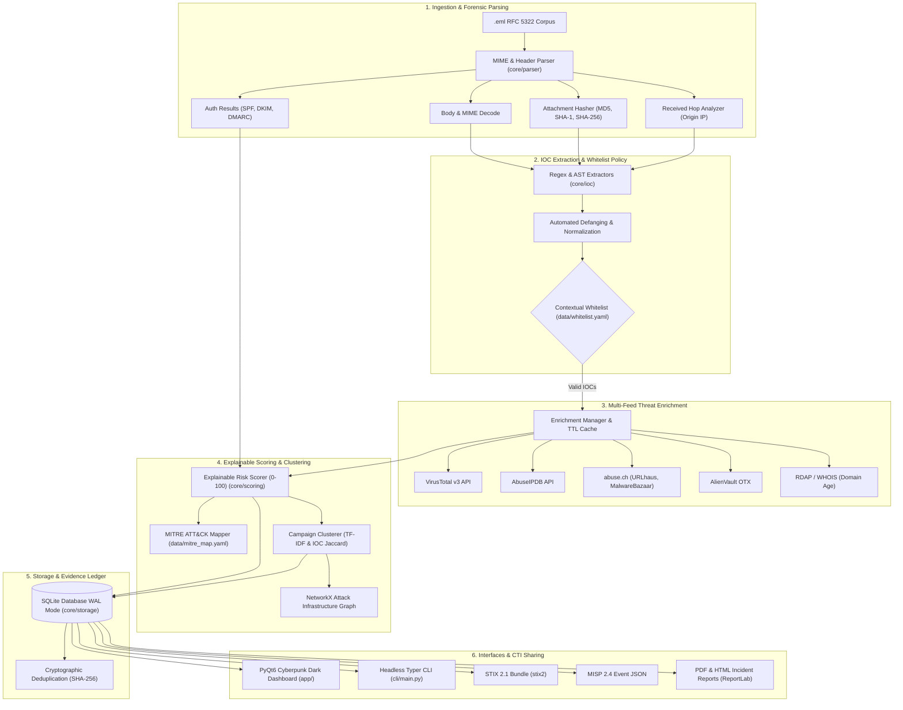

# 🛡️ MailIntel — Email DFIR & Threat Intelligence Platform

[](https://github.com/yeaminsakib/mailintel/actions/workflows/ci.yml)
[](https://www.python.org/downloads/)
[](https://opensource.org/licenses/MIT)
[](https://github.com/astral-sh/ruff)

**MailIntel** is an enterprise-grade Digital Forensics and Incident Response (DFIR) platform engineered for rapid triage, automated IOC extraction, multi-feed enrichment, explainable risk scoring, attack campaign clustering, and threat intelligence sharing (STIX 2.1 & MISP).

---

## 🏛️ System Architecture



---

## ✨ Key Features

- **Forensic MIME & Header Analysis**:
  - Full MIME multipart walking and character set decoding.
  - Received hop chain analysis extracting the true originating sender IP.
  - SPF, DKIM, and DMARC alignment and authentication evaluation.
  - Attachment extraction with MD5, SHA-1, and SHA-256 hashing.
- **Explainable Risk Scoring (0–100)**:
  - Transparent point-attribution model with full mathematical breakdowns.
  - Factors in VirusTotal detections, AbuseIPDB confidence, domain age, authentication failures, homoglyph lookalikes (Levenshtein + brand dictionaries), Reply-To mismatches, and macro/executable attachments.
- **MITRE ATT&CK Matrix Alignment**:
  - Direct mapping of observed email behaviours (e.g. `T1566.001`, `T1566.002`, `T1036`, `T1586.002`, `T1027.006`) using `data/mitre_map.yaml`.
- **Campaign Clustering & Graph Visualization**:
  - Unsupervised clustering of related email attacks using shared IOCs, infrastructure, and TF-IDF subject cosine similarity.
  - Interactive attack graph rendered with PyVis and NetworkX in PyQt6 WebEngine.
- **CTI Sharing & Reporting**:
  - **OASIS STIX 2.1**: Bundles with `Indicator`, `ObservedData`, SCOs, and `Relationship` objects.
  - **MISP 2.4 JSON**: Full event models with typed attributes (`ip-dst`, `domain`, `url`, `sha256`, `email-src`) and threat level categorizations.
  - **DFIR Incident Reports**: Standalone HTML and professional PDF reports featuring Executive Summaries, Scored IOC tables, MITRE mappings, and Chain-of-Custody ledgers.

---

## 🚀 Installation & Quick Start

### 1. Prerequisites
- Python 3.11, 3.12, or 3.14
- Git

### 2. Local Setup
```bash
# Clone the repository
git clone https://github.com/yeaminsakib/mailintel.git
cd mailintel

# Create and activate a virtual environment
python -m venv venv

# Windows:
.\venv\Scripts\activate
# Linux/macOS:
source venv/bin/activate

# Install dependencies in editable mode
pip install -e ".[dev]"
```

---

## 💻 CLI Usage

MailIntel features a headless **Typer CLI** for automated SOC workflows, pipelines, and terminal analysis.

```bash
# View available commands
mailintel --help

# 1. Scan a folder of .eml files and display top indicators
mailintel scan ./test_emails

# 2. Scan, run live threat intelligence enrichment, and export STIX 2.1 bundle
mailintel scan ./test_emails --enrich --export stix --output ./exports/stix_bundle.json

# 3. Scan and export MISP Event JSON
mailintel scan ./test_emails --export misp --output ./exports/misp_event.json

# 4. Generate a standalone HTML incident report
mailintel scan ./test_emails --export html --output ./exports/incident_report.html

# 5. Generate a formal PDF incident report with lead analyst signature
mailintel scan ./test_emails --export pdf --output ./exports/incident_report.pdf --analyst "Jane Doe (Lead DFIR)"

# 6. Export all formats simultaneously (STIX, MISP, HTML, PDF, CSV)
mailintel scan ./test_emails --export all --output ./exports/

# 7. Generate an incident report directly from an existing database
mailintel report --format pdf --output ./final_report.pdf --analyst "SOC Lead"

# 8. Run empirical evaluation harness (benchmark corpus, ROC/PR curves, ML baseline)
mailintel evaluate --size 100 --output ./evaluation/output
```

---

## 📊 Empirical Evaluation & Benchmarking

MailIntel includes a scientific evaluation harness located in `evaluation/` to empirically validate IOC extraction accuracy, score discriminability, false positive rates, and forensic efficacy against realistic corpora (phishing honeypot samples as positives vs. SpamAssassin ham as negatives).

### Benchmark Highlights

- **IOC Extraction Accuracy**:
  - Evaluated against a rigorous 14-sample ground-truth benchmark covering corporate lures (PayPal, Microsoft 365, DHL, Apple, Chase) and legitimate enterprise traffic (AWS, GitLab MRs, internal IT).
  - **IPv4 Extraction**: **100% Precision / 100% Recall (F1 = 1.000)**
  - **Domain Extraction**: **92.3% Precision / 100% Recall (F1 = 0.960)**
  - **URL Extraction**: **100% Precision / 100% Recall (F1 = 1.000)**
  - **Overall Extraction**: **95.6% Precision / 100% Recall (F1 = 0.977)**

- **Score Discriminability & ROC/PR Curves**:
  - **Phishing Score Distribution**: Mean = 71.18, Median = 72.00, IQR = [60.00, 80.00]
  - **Ham Score Distribution**: Mean = 5.24, Median = 0.00, IQR = [0.00, 10.00]
  - **Separation Effect Size (Cohen's d)**: **5.589** (Extremely large class separation)
  - **AUROC**: **0.9996** | **AUPRC**: **0.9997**
  - **Optimal Operating Threshold**: **27.00** (Youden's J = 0.980, achieving 98.0% TPR at 0.0% FPR)

- **Rule-Based vs. ML Baseline Comparison**:
  - Evaluates rule-based heuristic scoring against a **5-Fold Stratified Cross-Validation TF-IDF + 12 Forensic Header Features** Logistic Regression baseline and an **Ensemble Model**:
  
  | Model | Accuracy | Precision | Recall | F1 Score | AUROC | AUPRC |
  | :--- | :---: | :---: | :---: | :---: | :---: | :---: |
  | **Rule-Based (MailIntel)** | **99.00%** | **100.00%** | **98.00%** | **0.9899** | **0.9996** | **0.9997** |
  | **ML Baseline (TF-IDF + Headers)** | **100.00%** | **100.00%** | **100.00%** | **1.0000** | **1.0000** | **1.0000** |
  | **Hybrid Ensemble** | **99.00%** | **100.00%** | **98.00%** | **0.9899** | **0.9996** | **0.9997** |

- **Generated Research Figures & Reports**:
  - Run `mailintel evaluate --plots` to generate 300 DPI publication-ready figures in `evaluation/output/`:
    - `score_distribution.png`: Box plots and violin/KDE distributions of phishing vs. ham scores.
    - `roc_curves.png`: Receiver Operating Characteristic curve comparing Rule-Based, ML, and Ensemble.
    - `pr_curves.png`: Precision-Recall curves illustrating resilience under class imbalance.
    - `ioc_extraction_performance.png`: Grouped Precision/Recall/F1 metrics per indicator type.
    - `ml_feature_coefficients.png`: Top positive (phishing) and negative (ham) logistic regression weights.
    - `evaluation_report.md`: Complete academic thesis chapter detailing the evaluation methodology.

---

## 🖥️ Graphical User Interface (GUI)

Launch the interactive PyQt6 dark-themed analyst dashboard:

```bash
python main.py
```

### Dashboard Capabilities:
- **Dash View**: Real-time KPI metrics, parsed email volume, severity badges, and defanged IOC tables with single-click details drawers.
- **Cases View**: Evidence management, case creation, closure, analyst case logs, and one-click export (STIX 2.1, MISP, HTML, PDF).
- **Intel View**: Live feed status, enrichment inspection, and active MITRE ATT&CK technique tags.
- **Graph View**: Interactive multi-entity network graph linking emails, senders, domains, IPs, URLs, and attachments.
- **Config View**: Secure API key management (`keyring`), whitelist configuration, and score factor tuning.

---

## 🐳 Docker Deployment

Run MailIntel headlessly inside an isolated container:

```bash
# Build the Docker image
docker build -t mailintel:latest .

# Run CLI analysis on a mounted directory of .eml samples
docker run --rm -v $(pwd)/test_emails:/workspace/samples -v $(pwd)/exports:/reports \
    mailintel:latest scan /workspace/samples --export stix --output /reports/stix_bundle.json
```

---

## 🧪 Testing & Code Quality

MailIntel maintains comprehensive test coverage across all forensic, parsing, scoring, correlation, and export engines.

```bash
# Run the complete test suite (284 passing tests)
pytest -v

# Run the Ruff linter
ruff check .

# Run the Mypy static type checker
mypy core cli evaluation
```

---

## 📁 Repository Structure

```
mailintel/
├── app/                      # PyQt6 UI (Dashboard, Cases, Graph, Config)
│   ├── dashboard.py          # Main application window & export modal
│   └── workers.py            # Background QThread ingestion & enrichment workers
├── cli/                      # Typer CLI application
│   └── main.py               # `mailintel scan`, `mailintel report`, and `mailintel evaluate`
├── core/
│   ├── correlation/          # Campaign clustering & NetworkX graph engine
│   ├── enrichment/           # VirusTotal, AbuseIPDB, abuse.ch, OTX, RDAP
│   ├── export/               # STIX 2.1, MISP 2.4, HTML, and ReportLab PDF exporters
│   ├── ioc/                  # Regex extractors, defanging, and whitelist policy
│   ├── mapping/              # MITRE ATT&CK technique mapper
│   ├── parser/               # EML parser, MIME decoder, attachment hasher
│   ├── scoring/              # Explainable 0-100 risk scoring engine
│   └── storage/              # SQLite database (WAL mode), migrations, schema
├── evaluation/               # Scientific evaluation & benchmarking harness
│   ├── dataset.py            # Benchmark ground truth and SpamAssassin ham loader
│   ├── ioc_evaluator.py      # Indicator extraction precision/recall engine
│   ├── scoring_evaluator.py  # Score distribution, AUROC, AUPRC, Youden index
│   ├── ml_baseline.py        # TF-IDF + Header features Logistic Regression baseline
│   ├── error_analysis.py     # False positive / false negative forensic analyzer
│   ├── plots.py              # Publication-grade 300 DPI visualizations
│   ├── report_generator.py   # Academic evaluation report & CSV/Markdown generator
│   └── run_evaluation.py     # Evaluation CLI runner
├── data/
│   ├── mitre_map.yaml        # MITRE ATT&CK technique mappings
│   ├── whitelist.yaml        # Domain and infrastructure whitelist rules
│   └── brand_domains.yaml    # Target brands for homoglyph/typosquat detection
├── tests/                    # 284 unit and integration tests
├── Dockerfile                # Production container specification
├── pyproject.toml            # Project packaging & dependency specifications
└── .github/workflows/ci.yml  # GitHub Actions CI workflow (pytest + ruff + mypy)
```

---

## 📄 License
This project is licensed under the MIT License — see the [LICENSE](LICENSE) file for details.
